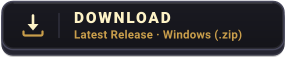
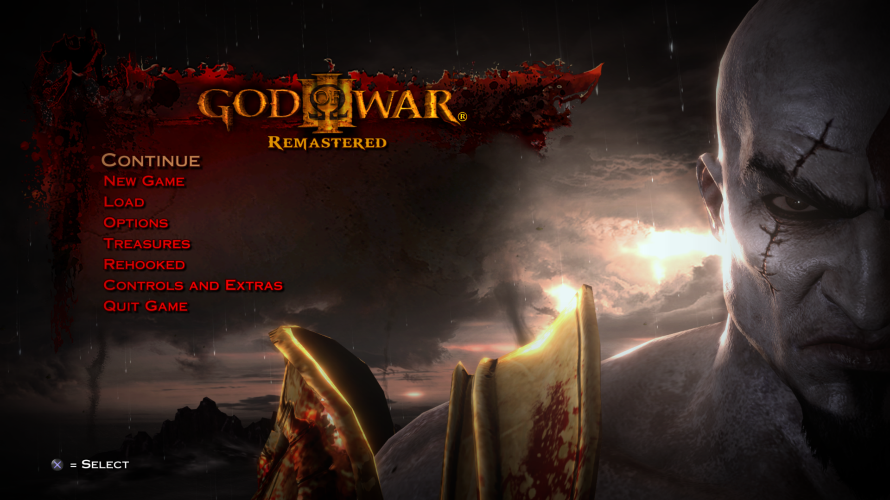
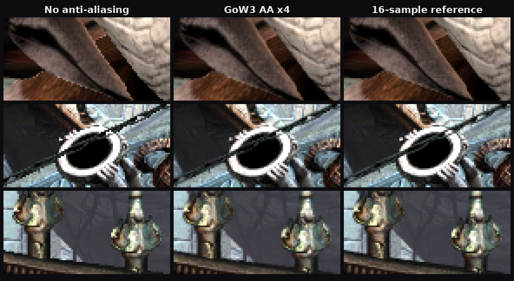
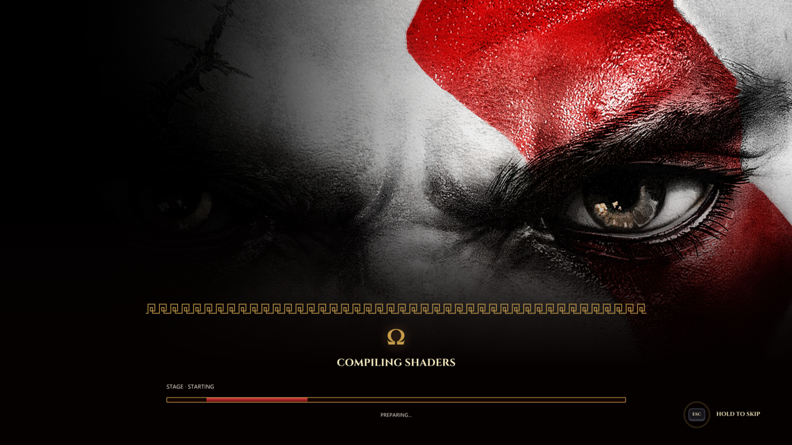
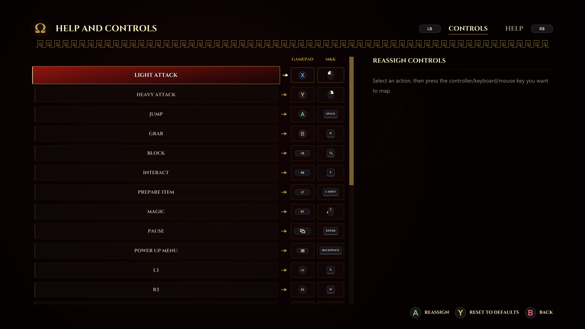
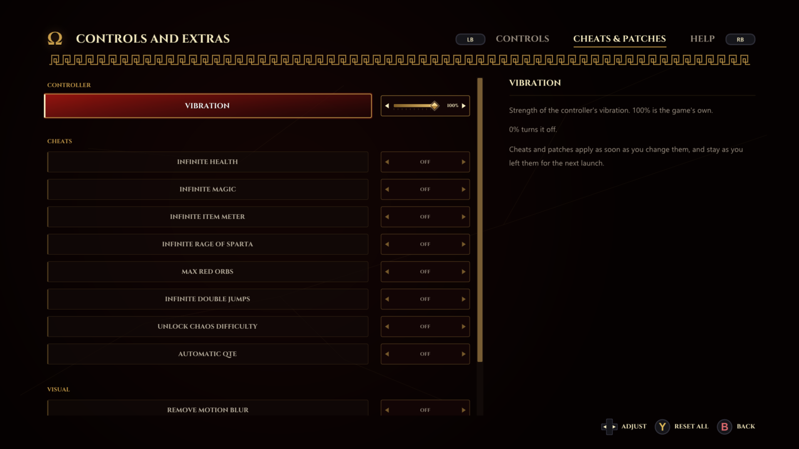
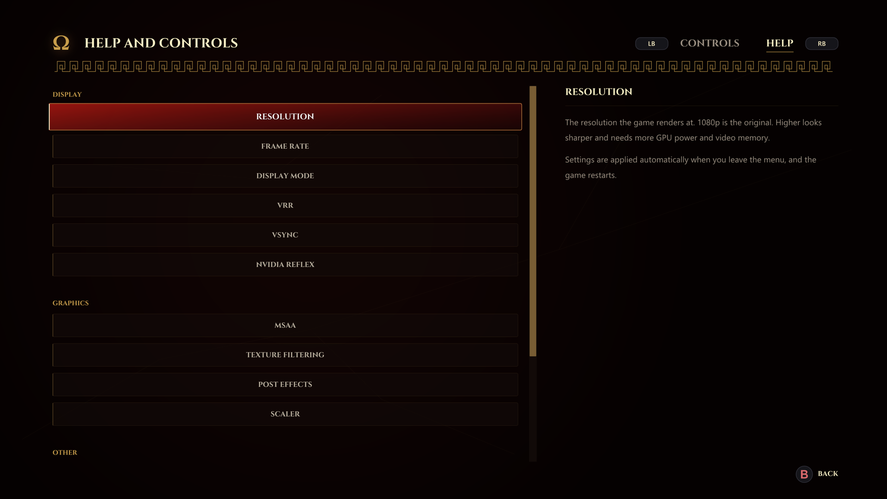
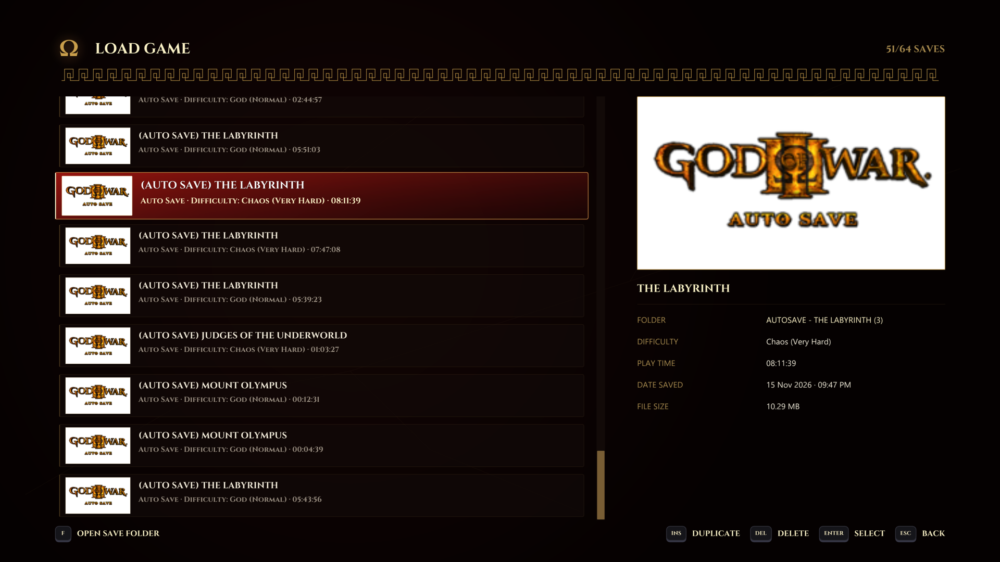
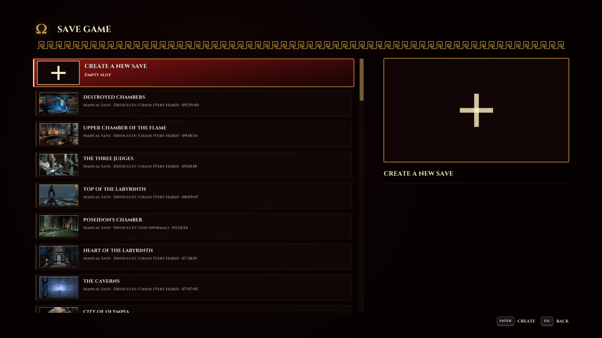

<h1 align="center">GOW3rehooked · Vulkan -8 and suport for older GPUS 
i</h1>

<p align="center"><b>God of War III Remastered on PC, tuned for older and 2 GB graphics cards.</b><br>
Runs on a GeForce GTX 750 Ti, with an anti-aliasing mode made for this game.</p>

<p align="center">
  <a href="https://github.com/Mathziz/GOW3rehooked/releases/latest"></a>
  <a href="https://github.com/Mathziz/GOW3rehooked/releases"></a>
  
  <a href="licenses/GPL-2.0-or-later.txt"></a>
</p>

<p align="center"><b>English</b> · <a href="README.pt-BR.md">Português (Brasil)</a></p>

## What is this?

[GOW3rehooked](https://github.com/cuesta4/GOW3rehooked) by cuesta4 lets you play **your own copy** of God of War III Remastered (PS4) natively on Windows and Linux. It is fast, but it needs a GTX 950 or newer, and older cards stop at `Create Vulkan device failed: -8`.

**This fork keeps everything from the original and makes it work on weaker PCs:**

| | What you get |
| --- | --- |
| 🖥️ **Older GPUs** | Runs on the GeForce GTX 750 Ti and other first-generation Maxwell cards. No more Vulkan error -8. |
| 🧠 **2 GB of video memory** | Texture data leaves video memory once it is uploaded, and textures move to system RAM near the limit. This fixed the scene-change freezes measured on a GTX 750 Ti. |
| ✨ **GoW3 AA** | Anti-aliasing that follows the game's real geometry. Smooth edges, sharp textures and HUD, at a fraction of MSAA's cost. |
| 🎚️ **More settings** | Shadow quality (Off, Low, Medium, High), FXAA, CMAA2 and GoW3 AA x1, x2 and x4. |
| ⌨️ **Keyboard and mouse** | In-game key prompts, Evade on Shift, an FPS counter (F10) and working F-key shortcuts. |

> [!IMPORTANT]
> **No game files are included.** You need your own copy of God of War III Remastered, European (CUSA01715) or American (CUSA01623) release, updated to version 1.02.

<p align="center">
  <a href="https://github.com/Mathziz/GOW3rehooked/releases/latest">
    
  </a>
</p>

<p align="center"></p>

## Quick start

1. **Download** the ZIP for your system from [Releases](https://github.com/Mathziz/GOW3rehooked/releases/latest): `…-Windows-x86_64.zip` or `…-Linux-x86_64.zip`.
2. **Extract it into the game folder**, next to `eboot.bin`, and let it replace the files.
3. **Run** `gow3.exe` on Windows or `./gow3.AppImage` on Linux. The first launches prepare the shaders behind a progress screen; after that the game starts fast.
4. **Pick your settings** under **Rehooked** in the title menu. The table below has a good starting point.

## Recommended settings

| Your graphics card | Settings |
| --- | --- |
| **2 GB** (GTX 750 Ti, GTX 950, GTX 1050) | Resolution **1080p** or **1440p**, MSAA **Off**, Post Effects **GoW3 AA x4**, Shadows **High**. Still short on FPS? Shadows **Medium**, or 1080p with Scaler **FSR 1** on a 1440p screen. |
| **4 GB or more** | MSAA **2x** + **GoW3 AA x4**, or MSAA **4x** for the best thin edges (chains, ropes). |

> [!WARNING]
> Avoid **MSAA 4x at 1440p on 2 GB cards**: it needs more video memory than the card has, and a long session can freeze.

Tested on a GeForce GTX 750 Ti 2 GB with a Core i5-6400: **60 FPS at 720p**, and **about 46 FPS at 1440p** with MSAA off and GoW3 AA x4 (median of a long session). Press **F10** in the game to see your own frame rate.

## GoW3 AA: anti-aliasing made for this game

Generic anti-aliasing filters guess where edges are from the colors, so they also blur textures, subtitles and the HUD. GoW3 AA asks the game instead. GOW3 already computes each pixel's distance to the camera for its shadows and depth of field, and GoW3 AA follows each object's real outline in that distance. Then it blends each edge pixel by how much of it the object covers, the same idea MSAA uses with its extra samples.



Measured against 8×8 supersampling, on surfaces with the game's own textures:

| Method | Edge error (lower is better) |
| --- | --- |
| No anti-aliasing | 100% |
| MSAA 2x | 62% |
| **GoW3 AA** | **48%** |
| MSAA 4x | 37% |

- **GoW3 AA**: the sharpest; smooths object outlines and creases.
- **GoW3 AA x2**: smooths creases and thin edges more strongly.
- **GoW3 AA x4**: x2 plus extra smoothing on thin geometry (chains, ropes, spikes). The recommended choice.

It works with MSAA too: over MSAA 2x it blends less, and over MSAA 4x it leaves object outlines as MSAA drew them. Thin lines smaller than a pixel are the one place where MSAA still wins.

## Requirements

| Component | Requirement |
| --- | --- |
| Operating system | Windows 10 or 11, or Linux x86-64 |
| CPU | Intel 4th-generation Core (Haswell) or newer, or AMD Ryzen 1000 or newer (x86-64-v3: AVX2, BMI1/2, FMA, F16C, LZCNT, MOVBE). Six cores or more recommended. |
| NVIDIA GPU | GeForce GTX 750 Ti (Maxwell, 1st generation) or newer |
| AMD GPU | Radeon RX 5300 (RDNA 1) or newer. Vega and Polaris: experimental. |
| Intel GPU | UHD Graphics: experimental. Arc and Xe: untested. |
| Memory | 16 GB of RAM recommended |
| Video memory | 2 GB: up to 1440p with MSAA off or 2x (see the settings above). 4 GB or more for MSAA 4x at 1440p. |
| Game | God of War III Remastered, CUSA01715 (Europe) or CUSA01623 (America), version 1.02 |

Please update your graphics driver. The renderer needs Vulkan 1.3 with depth clip control, push descriptors and conditional rendering. On GPUs without sparse buffer residency or min/max sampler filtering, such as the GTX 750 Ti, the game switches those off and uses a fallback for each.

## Installation

### Windows

1. Download `…-Windows-x86_64.zip` from [Releases](https://github.com/Mathziz/GOW3rehooked/releases/latest).
2. Extract it into the game folder, next to `eboot.bin`:

   ```text
   God of War III\
   ├── eboot.bin
   ├── sce_module\
   ├── sce_sys\
   ├── EXEC\ ...
   ├── gow3.exe
   ├── gow3_debug.cmd
   ├── licenses\
   └── _rehooked_\      the shader recipes; everything else is created on first launch
   ```

3. Run `gow3.exe`.

### Linux

1. Download `…-Linux-x86_64.zip` from [Releases](https://github.com/Mathziz/GOW3rehooked/releases/latest).
2. Extract it into the game folder, next to `eboot.bin`.
3. Run `./gow3.AppImage`. If your extractor dropped the executable bits, run `chmod +x gow3*.AppImage` first. On systems without FUSE, run `APPIMAGE_EXTRACT_AND_RUN=1 ./gow3.AppImage`.

### Updating and uninstalling

To update, extract the new ZIP over the old files. Your settings, saves and prepared shaders live in `_rehooked_` and stay as they are. To uninstall, delete `gow3.exe` and `gow3_debug.cmd` (or the two AppImages) and `licenses`, and `_rehooked_` too if you don't want to keep your saves.

| Path in `_rehooked_` | Contents |
| --- | --- |
| `settings/config.cfg` | Your Rehooked settings |
| `saves/` | Your saves |
| `shader_cache/` | Prepared shaders |
| `gow3.log` | The log, for bug reports |

## Settings

Open **Rehooked** in the title menu. **Help** in Controls and Extras explains each option in the game too. Defaults are in bold.

### Display

| Option | Choices | What it does |
| --- | --- | --- |
| Resolution | 480p, 720p, **1080p**, 1440p, 1800p, 4K | The resolution the game renders at. 1080p is the original. Higher looks sharper and needs more GPU power and video memory. |
| Frame Rate | 30, 40, **60**, 120, 240, 480 FPS | The game keeps its normal speed at every rate. 40 FPS suits a 120 Hz or 240 Hz display, or VRR. |
| Display Mode | Windowed, **Borderless**, Exclusive | Windowed: a resizable window. Borderless: full screen at the desktop's resolution. Exclusive: full screen, switching the display to the game's resolution and frame rate. |
| VRR | **Off**, On | For G-SYNC and FreeSync displays, full screen only. |
| VSync | **FIFO**, Mailbox, Off | FIFO: no tearing, more input lag. Mailbox: no tearing, less lag, more GPU work. Off: least lag, may tear. |
| NVIDIA Reflex | **Off**, On | Lowers input lag when the GPU is the limit. Needs a compatible NVIDIA GPU and driver. |

### Graphics

| Option | Choices | What it does |
| --- | --- | --- |
| MSAA | Off, **2x**, 4x | The game's own edge smoothing. 2x is the original. Each step needs more GPU power and video memory. |
| Texture Filtering | **Trilinear**, 4x, 8x, 16x | 4x to 16x anisotropic keeps textures sharp at steep angles, at a small GPU cost. |
| Post Effects | **Off**, FXAA, CMAA2, GoW3 AA, GoW3 AA x2, GoW3 AA x4 | Edge smoothing after the image is drawn. FXAA is the lightest. CMAA2 keeps textures sharper. GoW3 AA follows the game's geometry (see above). |
| Shadows | Off, Low, Medium, **High** | High is the original (2048 shadow maps). Medium and Low draw them at 1536 and 1024: faster, with softer shadow edges. Off removes the sun's shadows and saves the most GPU time. |
| Scaler | **Bilinear**, FSR 1 / Lanczos 2 | How the image is resized to your display when the sizes differ. FSR 1 enlarges and Lanczos 2 shrinks with more detail. |

### Other

| Option | Choices | What it does |
| --- | --- | --- |
| Skip Opening Logos | **Off**, On | Starts the game at the title menu. |
| Skip Videos with X | Off, **On** | Press Cross to skip any video or cutscene. |
| 4K Cinematics | **Off**, On | Plays your own 4K versions of the cinematics: files with the original names in `EXEC/CINEMATICS/4K`. |
| Button Icons | **Auto**, PlayStation, Keyboard | The game's own prompts. Keyboard shows your keys and mouse buttons; Auto does so when no gamepad is connected at startup. |
| Shader Mechanism | JIT, **AOT** | AOT prepares the shaders before you play, so stutter is rare. JIT translates each shader when it first appears, which can stutter. |
| Shader Recompilation | Sync, **Async** | Async: no stutter, but an object can appear a moment late. Sync: nothing appears late, but a hitch is possible. |
| Lazy AOT | Off, **On** | On: the first shader preparation is split over up to four launches. Off: it is done in one. |

<details>
<summary><b>Shaders prepared in advance (why the first launches show a progress screen)</b></summary>

<br>

A shader is a small program the graphics card runs to draw a surface or an effect. The game's shaders were written for the PS4's GPU, so each one has to be translated before your graphics card can run it. Emulators usually translate a shader the first time the game needs it, in the middle of gameplay, and that pause is the familiar shader stutter.

GOW3rehooked translates the game's shaders before gameplay instead, behind a progress screen at startup (AOT, ahead of time, the default). The work is spread over up to four launches, so the first one isn't a long wait, and the results are saved for the next launches. JIT (just in time) stays active as a safety net for any shader the preparation didn't catch. Holding Esc, Circle or B on the preparation screen skips it, and the game then restarts once with JIT alone.

<p align="center"></p>

</details>

<details>
<summary><b>Controls, cheats and patches</b></summary>

<br>

You can play with a gamepad or with keyboard and mouse. Open **Controls and Extras** from the title menu or from the game's Options menu during play.

- **Tools** schedules shader compilation, imports saves and restores the default Rehooked settings.
- **Controls** remaps the gamepad and the keyboard and mouse.
- **Cheats & Patches** holds the controller's vibration strength, cheats and visual patches.
- **Help** explains each Rehooked setting.

With the keyboard, **Evade** (L Shift by default) rolls Kratos toward the direction you move. Shortcuts: **F10** shows the frame rate, **F11** switches full screen, **F8** reloads the controls and **Ctrl + Shift + End** quits. The other F keys are free to bind to actions.

| Option | What it does |
| --- | --- |
| Vibration | Strength of the controller's vibration, from 0% (off) to **100%** (the game's own). |
| Infinite Health / Magic / Item Meter / Rage of Sparta | The meter stays full. |
| Max Red Orbs | Red orbs stay at the maximum, so every upgrade can be bought. |
| Infinite Double Jumps | Kratos can jump again in the air as many times as you like. |
| Unlock Chaos Difficulty | Chaos can be chosen in New Game without finishing the game first. |
| Automatic QTE | Quick-time prompts answer themselves. |
| Remove Motion Blur | Removes the blur on the camera and on fast-moving objects. |
| Remove Depth of Field | Removes the background blur of cutscenes and close camera shots. |

Every cheat and patch is off by default. Thanks to **SpartanPort** and **Celogamez** for developing, researching and porting them.

<table>
  <tr>
    <td width="33%"></td>
    <td width="33%"></td>
    <td width="33%"></td>
  </tr>
  <tr>
    <td align="center">Controls</td>
    <td align="center">Cheats &amp; Patches</td>
    <td align="center">Help</td>
  </tr>
</table>

</details>

<details>
<summary><b>Menus and saves</b></summary>

<br>

Continue appears above New Game once you have a save and directly loads the latest. The game has 64 manual save slots here (32 originally). The save and load screens let you duplicate or delete saves, and Open Save Folder opens the selected save in your file manager.

On first launch, the game offers to import existing saves from **shadPS4** or **SpartanPort**, American (`CUSA01623`) or European (`CUSA01715`). To import later, open **Controls and Extras → Tools → Import saves** from the title menu. If the automatic search doesn't find your saves, choose the `CUSA…` folder, its parent, or a save slot inside it.

The Rehooked menus follow the game's text language, set in the game's Options menu.

<table>
  <tr>
    <td width="50%"></td>
    <td width="50%"></td>
  </tr>
</table>

</details>

## Troubleshooting

- **"EBOOT.BIN NOT FOUND"**: the launcher is not in the game folder. Put `gow3.exe` or `gow3.AppImage` next to `eboot.bin`.
- **"YOUR GAME IS COMPRESSED"**: the folder holds a packaged game. Extract it first.
- **"YOUR GAME IS NOT VERSION 1.02"**: install the game's 1.02 update, or check that it is the CUSA01715 or CUSA01623 release.
- **The game freezes after a while on a 2 GB card**: lower MSAA (Off or 2x) or the resolution. Most freezes measured on 2 GB cards came from video memory over its limit.
- **It crashed before the title menu**: the next launch offers to reset your settings. Answer Yes if the crashes began after you changed one.
- **Restoring defaults**: open **Controls and Extras → Tools → Reset settings**, or delete `_rehooked_/settings/config.cfg`.

## Reporting bugs

Open an issue on the [Issues](https://github.com/Mathziz/GOW3rehooked/issues) page with `gow3.log`. A debug dump makes the problem much easier to fix:

1. Start the game with `gow3_debug.cmd` on Windows, or `gow3_debug.AppImage` on Linux. It runs slower with diagnostics on.
2. Reproduce the problem. If it is visual, press **F9** while it is on screen and wait for **DEBUG DUMP SAVED** in the bottom-left corner.
3. Close the game, and attach `_rehooked_/gow3.log` and the newest `gow3-<date>-<time>.zip` (or all its `.partN.zip` files).
4. Say what happened, where in the game, your settings, and your CPU, GPU, driver and system.

Please don't take reports about this fork to the shadPS4 developers or to the original GOW3rehooked.

<details>
<summary><b>Building from source</b></summary>

<br>

Use Clang and LLD, a C++23 standard library such as libstdc++ 14, CMake, Ninja, NASM, Vulkan headers 1.4.328 or newer, `glslc`, shaderc, glslang, SPIRV-Tools and libunwind. The [workflow](.github/workflows/windows.yml) lists the Ubuntu 24.04 packages. Run `bash build-fast.sh --release`, then `build-fast/Linux/Release/bin/gow3 --game-dir /path/to/game`.

</details>

## Credits

- [cuesta4](https://github.com/cuesta4/GOW3rehooked), the author of GOW3rehooked, which this fork is built on. All the core work is theirs.
- [SpartanPort](https://github.com/FelipePrado0/SpartanPort), whose way of running without sparse buffer residency this fork adapts, and whose launcher's keyboard prompts guided the in-game ones.
- The [shadPS4](https://github.com/shadps4-emu/shadPS4) team, for the PS4 kernel, system library and loader work the system layer is built on.
- kvicken, for the original resolution patches.
- Third-party components: [SDL3](https://github.com/libsdl-org/SDL), [Dear ImGui](https://github.com/ocornut/imgui), [FFmpeg](https://ffmpeg.org), [AMD FidelityFX Super Resolution 1](https://github.com/GPUOpen-Effects/FidelityFX-FSR), [Intel CMAA2](https://github.com/GameTechDev/CMAA2), [shaderc](https://github.com/google/shaderc) with [glslang](https://github.com/KhronosGroup/glslang) and [SPIRV-Tools](https://github.com/KhronosGroup/SPIRV-Tools), [Zydis](https://github.com/zyantific/zydis), [Xbyak](https://github.com/herumi/xbyak), [xxHash](https://github.com/Cyan4973/xxHash), [Zstandard](https://github.com/facebook/zstd), [fmt](https://github.com/fmtlib/fmt), [magic_enum](https://github.com/Neargye/magic_enum), [stb](https://github.com/nothings/stb), [LibAtrac9](https://github.com/Thealexbarney/LibAtrac9) and the [Cinzel](https://github.com/NDISCOVER/Cinzel) typeface.

## License

GOW3rehooked is licensed under the GNU General Public License v2.0 or later. Third-party components keep their own licenses, and their texts are in [`licenses/`](licenses).

God of War is a trademark of Sony Interactive Entertainment. This project is not affiliated with or endorsed by Sony Interactive Entertainment or Santa Monica Studio, and it contains no game code or assets.

The software is provided as is, without warranty of any kind.
