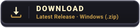
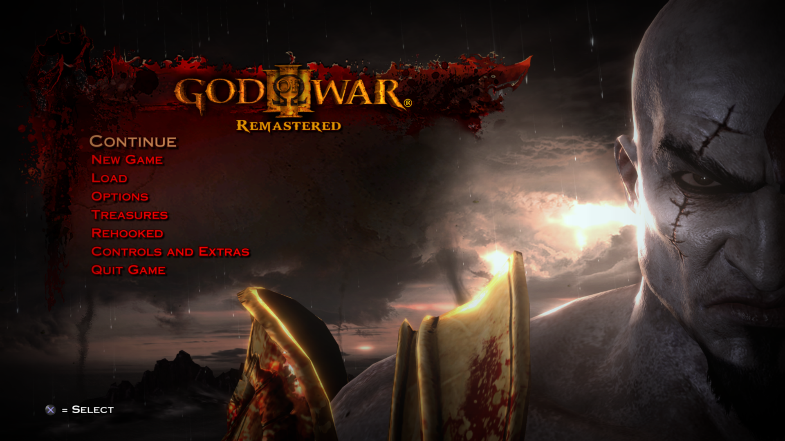
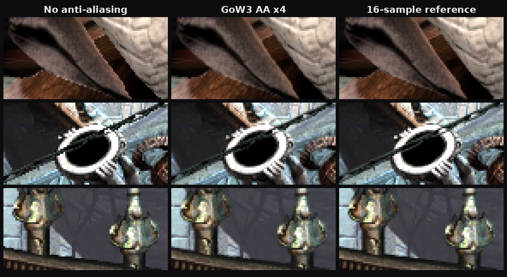
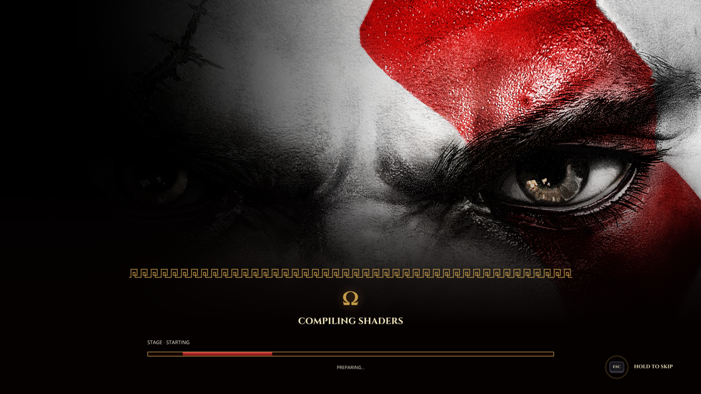
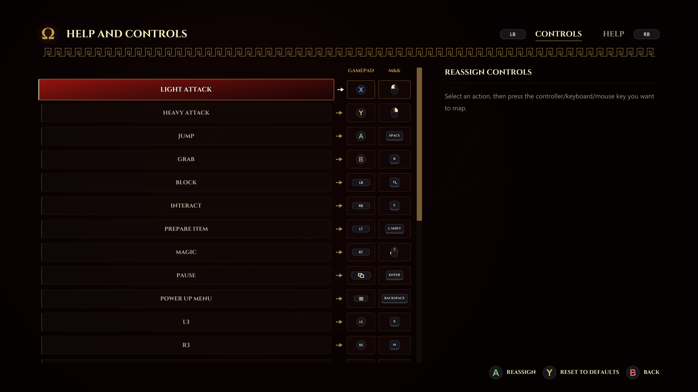
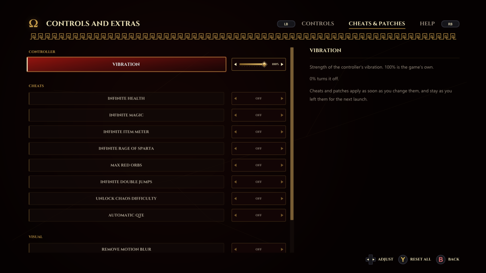
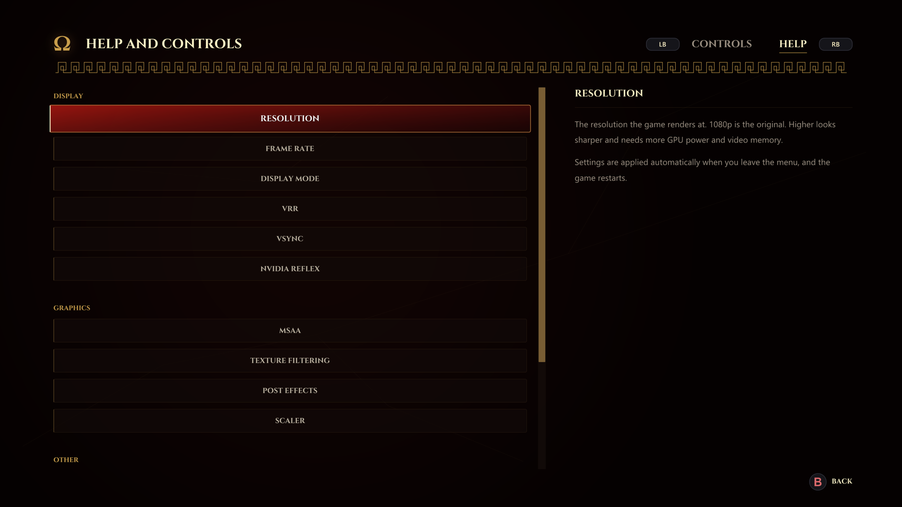
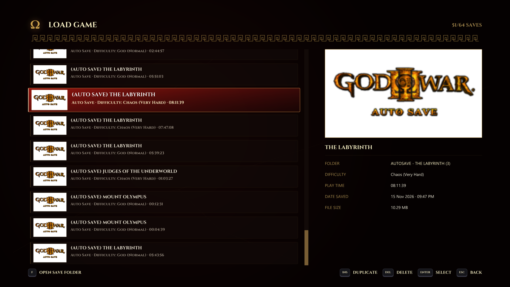
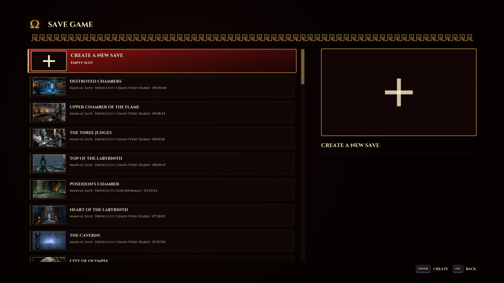

<h1 align="center">GOW3rehooked · fusion-750ti</h1>

<p align="center"><b>God of War III Remastered no PC, ajustado para placas de vídeo antigas e de 2 GB.</b><br>
Roda numa GeForce GTX 750 Ti, com um antisserrilhado feito para este jogo.</p>

<p align="center">
  <a href="https://github.com/Mathziz/GOW3rehooked/releases/latest"></a>
  <a href="https://github.com/Mathziz/GOW3rehooked/releases"></a>
  
  <a href="licenses/GPL-2.0-or-later.txt"></a>
</p>

<p align="center"><a href="README.md">English</a> · <b>Português (Brasil)</b></p>

## O que é isto?

O [GOW3rehooked](https://github.com/cuesta4/GOW3rehooked), do cuesta4, permite jogar a **sua própria cópia** de God of War III Remastered (PS4) direto no Windows e no Linux. Ele é rápido, mas exige uma GTX 950 ou mais nova; nas placas mais antigas, para no erro `Create Vulkan device failed: -8`.

**Este fork mantém tudo do original e faz o jogo funcionar em PCs mais fracos:**

| | O que você ganha |
| --- | --- |
| 🖥️ **Placas antigas** | Roda na GeForce GTX 750 Ti e em outras Maxwell de 1ª geração, sem o erro -8 do Vulkan. |
| 🧠 **2 GB de memória de vídeo** | As texturas saem da memória de vídeo depois de enviadas e vão para a RAM do PC perto do limite. Isso resolveu os travamentos nas trocas de cenário medidos numa GTX 750 Ti. |
| ✨ **GoW3 AA** | Antisserrilhado que segue a geometria real do jogo: bordas suaves, texturas e HUD nítidos, por uma fração do custo do MSAA. |
| 🎚️ **Mais opções** | Qualidade das sombras (Desligado, Baixa, Média, Alta), FXAA, CMAA2 e GoW3 AA, x2 e x4. |
| ⌨️ **Teclado e mouse** | Ícones das teclas no jogo, esquiva no Shift, contador de FPS (F10) e atalhos F1–F12 funcionando. |

> [!IMPORTANT]
> **Nenhum arquivo do jogo vem incluído.** Você precisa da sua própria cópia de God of War III Remastered, versão europeia (CUSA01715) ou americana (CUSA01623), atualizada para a versão 1.02.

<p align="center">
  <a href="https://github.com/Mathziz/GOW3rehooked/releases/latest">
    
  </a>
</p>

<p align="center"></p>

## Começo rápido

1. **Baixe** o ZIP do seu sistema em [Releases](https://github.com/Mathziz/GOW3rehooked/releases/latest): `…-Windows-x86_64.zip` ou `…-Linux-x86_64.zip`.
2. **Extraia na pasta do jogo**, ao lado do `eboot.bin`, e deixe substituir os arquivos.
3. **Abra** o `gow3.exe` no Windows ou o `./gow3.AppImage` no Linux. Nas primeiras vezes, os shaders são preparados numa tela de progresso; depois o jogo abre rápido.
4. **Escolha as opções** em **Rehooked**, no menu inicial. A tabela abaixo é um bom ponto de partida.

## Configuração recomendada

| Sua placa de vídeo | Configuração |
| --- | --- |
| **2 GB** (GTX 750 Ti, GTX 950, GTX 1050) | Resolution **1080p** ou **1440p**, MSAA **Off**, Post Effects **GoW3 AA x4**, Shadows **High**. Ainda falta FPS? Shadows **Medium**, ou 1080p com Scaler **FSR 1** num monitor 1440p. |
| **4 GB ou mais** | MSAA **2x** + **GoW3 AA x4**, ou MSAA **4x** para o melhor resultado em bordas finas (correntes, cordas). |

> [!WARNING]
> Evite **MSAA 4x em 1440p numa placa de 2 GB**: ele precisa de mais memória de vídeo do que a placa tem, e uma sessão longa pode travar.

Testado numa GeForce GTX 750 Ti 2 GB com Core i5-6400: **60 FPS em 720p** e **cerca de 46 FPS em 1440p** com MSAA desligado e GoW3 AA x4 (mediana de uma sessão longa). Aperte **F10** no jogo para ver o seu FPS.

## GoW3 AA: antisserrilhado feito para este jogo

Os filtros de antisserrilhado comuns adivinham onde estão as bordas pelas cores, e por isso também borram texturas, legendas e HUD. O GoW3 AA pergunta ao jogo. O GOW3 já calcula a distância de cada pixel até a câmera para as sombras e a profundidade de campo, e o GoW3 AA segue por essa distância o contorno real de cada objeto. Depois, mistura cada pixel da borda conforme o quanto o objeto cobre dele, a mesma ideia que o MSAA usa com suas amostras extras.



Medido contra supersampling 8×8, em superfícies com as texturas do próprio jogo:

| Método | Erro nas bordas (menor é melhor) |
| --- | --- |
| Sem antisserrilhado | 100% |
| MSAA 2x | 62% |
| **GoW3 AA** | **48%** |
| MSAA 4x | 37% |

- **GoW3 AA**: o mais nítido; suaviza os contornos dos objetos e as quinas.
- **GoW3 AA x2**: suaviza mais forte as quinas e as bordas finas.
- **GoW3 AA x4**: o x2 com suavização extra na geometria fina (correntes, cordas, espinhos). É o recomendado.

Também funciona junto com o MSAA: sobre o MSAA 2x, ele mistura menos, e sobre o MSAA 4x, deixa os contornos como o MSAA desenhou. Linhas mais finas que um pixel são o único caso em que o MSAA ainda ganha.

## Requisitos

| Componente | Requisito |
| --- | --- |
| Sistema | Windows 10 ou 11, ou Linux x86-64 |
| Processador | Intel Core de 4ª geração (Haswell) ou mais novo, ou AMD Ryzen 1000 ou mais novo (x86-64-v3: AVX2, BMI1/2, FMA, F16C, LZCNT, MOVBE). Seis núcleos ou mais recomendados. |
| Placa NVIDIA | GeForce GTX 750 Ti (Maxwell de 1ª geração) ou mais nova |
| Placa AMD | Radeon RX 5300 (RDNA 1) ou mais nova. Vega e Polaris: experimental. |
| Placa Intel | UHD Graphics: experimental. Arc e Xe: não testadas. |
| Memória | 16 GB de RAM recomendados |
| Memória de vídeo | 2 GB: até 1440p com MSAA desligado ou 2x (veja a configuração acima). 4 GB ou mais para MSAA 4x em 1440p. |
| Jogo | God of War III Remastered, CUSA01715 (Europa) ou CUSA01623 (América), versão 1.02 |

Atualize o driver da placa de vídeo. O renderizador precisa de Vulkan 1.3 com depth clip control, push descriptors e conditional rendering. Em placas sem sparse buffer residency ou filtragem min/max, como a GTX 750 Ti, o jogo desliga esses recursos e usa uma alternativa para cada um.

## Instalação

### Windows

1. Baixe o `…-Windows-x86_64.zip` em [Releases](https://github.com/Mathziz/GOW3rehooked/releases/latest).
2. Extraia na pasta do jogo, ao lado do `eboot.bin`:

   ```text
   God of War III\
   ├── eboot.bin
   ├── sce_module\
   ├── sce_sys\
   ├── EXEC\ ...
   ├── gow3.exe
   ├── gow3_debug.cmd
   ├── licenses\
   └── _rehooked_\      receitas dos shaders; o resto é criado na primeira vez que o jogo abre
   ```

3. Abra o `gow3.exe`.

### Linux

1. Baixe o `…-Linux-x86_64.zip` em [Releases](https://github.com/Mathziz/GOW3rehooked/releases/latest).
2. Extraia na pasta do jogo, ao lado do `eboot.bin`.
3. Abra o `./gow3.AppImage`. Se o extrator tirou a permissão de execução, rode antes `chmod +x gow3*.AppImage`. Em sistemas sem FUSE, use `APPIMAGE_EXTRACT_AND_RUN=1 ./gow3.AppImage`.

### Atualizar e desinstalar

Para atualizar, extraia o ZIP novo por cima dos arquivos antigos. Suas opções, saves e shaders preparados ficam em `_rehooked_` e continuam como estão. Para desinstalar, apague `gow3.exe` e `gow3_debug.cmd` (ou os dois AppImages) e a pasta `licenses`, e também `_rehooked_` se não quiser guardar os saves.

| Caminho em `_rehooked_` | Conteúdo |
| --- | --- |
| `settings/config.cfg` | Suas opções do Rehooked |
| `saves/` | Seus saves |
| `shader_cache/` | Shaders preparados |
| `gow3.log` | O log, para relatar problemas |

## Opções

Abra **Rehooked** no menu inicial. A aba **Help**, em Controls and Extras, também explica cada opção dentro do jogo. Os padrões estão em negrito.

### Tela (Display)

| Opção | Escolhas | O que faz |
| --- | --- | --- |
| Resolution | 480p, 720p, **1080p**, 1440p, 1800p, 4K | A resolução em que o jogo renderiza. 1080p é a original. Mais alta fica mais nítida e exige mais da GPU e da memória de vídeo. |
| Frame Rate | 30, 40, **60**, 120, 240, 480 FPS | O jogo mantém a velocidade normal em qualquer taxa. 40 FPS combina com telas de 120 Hz ou 240 Hz, ou com VRR. |
| Display Mode | Windowed, **Borderless**, Exclusive | Janela redimensionável, tela cheia na resolução da área de trabalho, ou tela cheia exclusiva na resolução e taxa do jogo. |
| VRR | **Off**, On | Para monitores G-SYNC e FreeSync, só em tela cheia. |
| VSync | **FIFO**, Mailbox, Off | FIFO: sem tearing, mais atraso. Mailbox: sem tearing, menos atraso, mais trabalho da GPU. Off: menor atraso, pode ter tearing. |
| NVIDIA Reflex | **Off**, On | Reduz o atraso dos comandos quando a GPU é o limite. Precisa de placa e driver NVIDIA compatíveis. |

### Gráficos (Graphics)

| Opção | Escolhas | O que faz |
| --- | --- | --- |
| MSAA | Off, **2x**, 4x | A suavização de bordas do próprio jogo. 2x é o original. Cada nível exige mais da GPU e da memória de vídeo. |
| Texture Filtering | **Trilinear**, 4x, 8x, 16x | Anisotrópico de 4x a 16x mantém as texturas nítidas em ângulos inclinados, com pouco custo. |
| Post Effects | **Off**, FXAA, CMAA2, GoW3 AA, GoW3 AA x2, GoW3 AA x4 | Suavização de bordas depois de a imagem ser desenhada. O FXAA é o mais leve. O CMAA2 mantém as texturas mais nítidas. O GoW3 AA segue a geometria do jogo (veja acima). |
| Shadows | Off, Low, Medium, **High** | High é o original (mapas de sombra de 2048). Medium e Low desenham em 1536 e 1024: mais rápido, com bordas de sombra mais suaves. Off tira as sombras do sol e é a maior economia de GPU. |
| Scaler | **Bilinear**, FSR 1 / Lanczos 2 | Como a imagem é redimensionada para a sua tela quando os tamanhos diferem. FSR 1 amplia e Lanczos 2 reduz com mais detalhe. |

### Outras (Other)

| Opção | Escolhas | O que faz |
| --- | --- | --- |
| Skip Opening Logos | **Off**, On | O jogo começa direto no menu inicial. |
| Skip Videos with X | Off, **On** | Aperte X para pular qualquer vídeo ou cena. |
| 4K Cinematics | **Off**, On | Toca as suas versões em 4K das cinemáticas: arquivos com os nomes originais em `EXEC/CINEMATICS/4K`. |
| Button Icons | **Auto**, PlayStation, Keyboard | Os ícones do próprio jogo. Keyboard mostra as suas teclas e botões do mouse; Auto faz isso quando nenhum controle está conectado ao abrir o jogo. |
| Shader Mechanism | JIT, **AOT** | AOT prepara os shaders antes de jogar, então quase não há engasgos. JIT traduz cada shader quando ele aparece, o que pode engasgar. |
| Shader Recompilation | Sync, **Async** | Async: sem engasgo, mas um objeto pode aparecer um instante atrasado. Sync: nada aparece atrasado, mas pode haver um engasgo. |
| Lazy AOT | Off, **On** | On: a primeira preparação dos shaders é dividida em até quatro aberturas. Off: é feita de uma vez. |

<details>
<summary><b>Por que as primeiras aberturas mostram uma tela de progresso</b></summary>

<br>

Um shader é um pequeno programa que a placa de vídeo roda para desenhar uma superfície ou um efeito. Os shaders do jogo foram escritos para a GPU do PS4, então cada um precisa ser traduzido antes de rodar na sua placa. Emuladores costumam traduzir cada shader na primeira vez que o jogo precisa dele, no meio da partida, e essa pausa é o famoso engasgo de shader.

O GOW3rehooked traduz os shaders antes de jogar, numa tela de progresso na abertura (AOT, o padrão). O trabalho é dividido em até quatro aberturas, para a primeira não demorar demais, e o resultado fica salvo. O JIT continua ativo como rede de segurança para qualquer shader que a preparação não pegou. Segurar Esc, Círculo ou B na tela de preparação pula essa etapa, e o jogo reabre uma vez só com JIT.

<p align="center"></p>

</details>

<details>
<summary><b>Controles, trapaças e patches</b></summary>

<br>

Dá para jogar com controle ou com teclado e mouse. Abra **Controls and Extras** no menu inicial ou no menu Options durante o jogo.

- **Tools**: agenda a compilação de shaders, importa saves e restaura as opções padrão.
- **Controls**: remapeia o controle, o teclado e o mouse.
- **Cheats & Patches**: força da vibração, trapaças e patches visuais.
- **Help**: explica cada opção do Rehooked.

No teclado, a **esquiva** (Shift esquerdo, por padrão) faz o Kratos rolar na direção em que você anda. Atalhos: **F10** mostra o FPS, **F11** alterna a tela cheia, **F8** recarrega os controles e **Ctrl + Shift + End** fecha o jogo. As outras teclas F ficam livres para ações.

| Opção | O que faz |
| --- | --- |
| Vibration | Força da vibração do controle, de 0% (desligada) a **100%** (a do jogo). |
| Infinite Health / Magic / Item Meter / Rage of Sparta | A barra fica sempre cheia. |
| Max Red Orbs | Orbes vermelhos no máximo, para comprar todos os upgrades. |
| Infinite Double Jumps | O Kratos pode pular de novo no ar quantas vezes quiser. |
| Unlock Chaos Difficulty | Libera a dificuldade Chaos sem terminar o jogo antes. |
| Automatic QTE | Os comandos rápidos (QTE) se resolvem sozinhos. |
| Remove Motion Blur | Tira o borrão de movimento da câmera e dos objetos rápidos. |
| Remove Depth of Field | Tira o desfoque de fundo das cenas e dos planos de câmera próximos. |

Tudo vem desligado por padrão. Obrigado a **SpartanPort** e **Celogamez** pelo desenvolvimento, pesquisa e adaptação dessas trapaças e patches.

<table>
  <tr>
    <td width="33%"></td>
    <td width="33%"></td>
    <td width="33%"></td>
  </tr>
  <tr>
    <td align="center">Controles</td>
    <td align="center">Trapaças e patches</td>
    <td align="center">Ajuda</td>
  </tr>
</table>

</details>

<details>
<summary><b>Menus e saves</b></summary>

<br>

**Continue** aparece acima de New Game quando existe um save e carrega o mais recente direto. Aqui o jogo tem 64 espaços de save manual (o original tem 32). As telas de salvar e carregar permitem duplicar ou apagar saves, e Open Save Folder abre o save escolhido no gerenciador de arquivos.

Na primeira abertura, o jogo oferece importar saves do **shadPS4** ou do **SpartanPort**, americanos (`CUSA01623`) ou europeus (`CUSA01715`). Para importar depois, abra **Controls and Extras → Tools → Import saves** no menu inicial. Se a busca automática não achar seus saves, escolha a pasta `CUSA…`, a pasta acima dela ou um save dentro dela.

Os menus do Rehooked seguem o idioma de texto do jogo, que você escolhe no menu Options do jogo.

<table>
  <tr>
    <td width="50%"></td>
    <td width="50%"></td>
  </tr>
</table>

</details>

## Problemas comuns

- **"EBOOT.BIN NOT FOUND"**: o jogo não está na pasta certa. Coloque o `gow3.exe` ou o `gow3.AppImage` ao lado do `eboot.bin`.
- **"YOUR GAME IS COMPRESSED"**: a pasta tem o jogo empacotado. Extraia antes.
- **"YOUR GAME IS NOT VERSION 1.02"**: instale a atualização 1.02 do jogo, ou confira se é a versão CUSA01715 ou CUSA01623.
- **O jogo trava depois de um tempo numa placa de 2 GB**: baixe o MSAA (Off ou 2x) ou a resolução. A maioria dos travamentos medidos em placas de 2 GB veio da memória de vídeo acima do limite.
- **Fechou antes do menu inicial**: na próxima abertura, o jogo oferece restaurar as opções. Responda Yes se os fechamentos começaram depois de mudar alguma opção.
- **Voltar ao padrão**: abra **Controls and Extras → Tools → Reset settings**, ou apague `_rehooked_/settings/config.cfg`.

## Relatar problemas

Abra um relato na página [Issues](https://github.com/Mathziz/GOW3rehooked/issues) com o `gow3.log`. Um dump de diagnóstico facilita muito a correção:

1. Abra o jogo pelo `gow3_debug.cmd` no Windows, ou pelo `gow3_debug.AppImage` no Linux. Com o diagnóstico ligado, o jogo fica mais lento.
2. Faça o problema acontecer. Se for visual, aperte **F9** com ele na tela e espere aparecer **DEBUG DUMP SAVED** no canto inferior esquerdo.
3. Feche o jogo e anexe `_rehooked_/gow3.log` e o `gow3-<data>-<hora>.zip` mais novo (ou todas as partes `.partN.zip`).
4. Conte o que aconteceu, em que parte do jogo, suas opções, e seu processador, placa de vídeo, driver e sistema.

Não leve relatos deste fork aos desenvolvedores do shadPS4 nem ao GOW3rehooked original.

## Créditos

- [cuesta4](https://github.com/cuesta4/GOW3rehooked), autor do GOW3rehooked, base deste fork. Todo o trabalho principal é dele.
- [SpartanPort](https://github.com/FelipePrado0/SpartanPort), de onde vem a forma de rodar sem sparse buffer residency adaptada aqui, e cujos ícones de teclado guiaram os do jogo.
- A equipe do [shadPS4](https://github.com/shadps4-emu/shadPS4), pelo trabalho de kernel, bibliotecas de sistema e carregador do PS4 em que a camada de sistema se baseia.
- kvicken, pelos patches de resolução originais.
- Componentes de terceiros: veja a lista completa no [README em inglês](README.md#credits).

## Licença

O GOW3rehooked é distribuído sob a GNU General Public License v2.0 ou posterior. Os componentes de terceiros mantêm suas licenças, com os textos em [`licenses/`](licenses).

God of War é uma marca registrada da Sony Interactive Entertainment. Este projeto não tem ligação com a Sony Interactive Entertainment nem com o Santa Monica Studio, não é endossado por elas e não contém código nem arquivos do jogo.

O software é oferecido como está, sem garantia de qualquer tipo.
